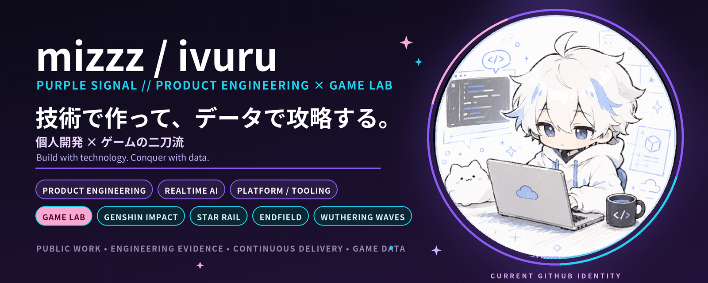
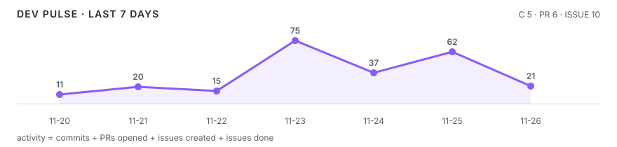
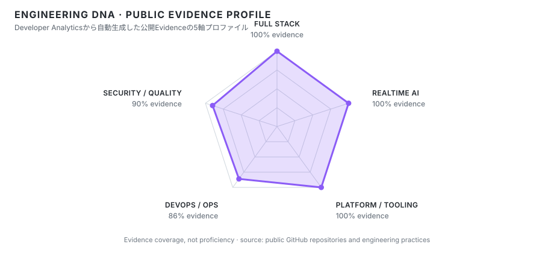
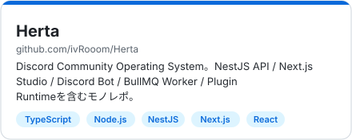
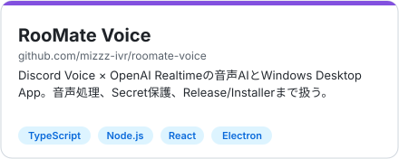
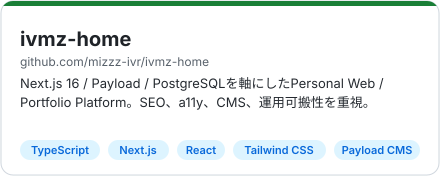
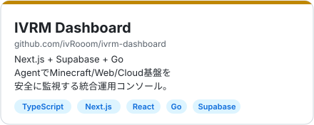
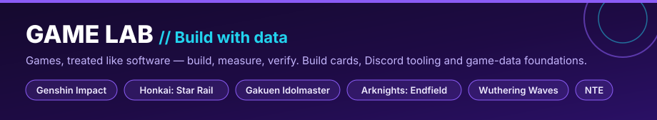

<strong>日本語</strong> · <a href="./README.en.md">English</a>

  

<h1 align="center">いゔる。 a.k.a. mizzz（ずーみー）</h1>

  <strong>技術で作って、データで攻略する。</strong> 
  個人開発 × ゲームの二刀流。プロダクト志向のフルスタックエンジニアとして、React / TypeScript を軸に Web・Discord・Realtime AI・API・DB・運用まで作る側。ゲームは計算・検証・ツール化までやるデータ派。

  
  
  

Discord / Community · Full-stack Product · Developer Platform · Realtime AI — 詳細は <a href="./SKILL_SHEET.md">Skill Sheet</a>

小さく作る · 速く磨く · 安全に運用する

---

<!-- PROFILE-SIGNAL:LIVE-SIGNAL:START -->
## LIVE SIGNAL // Development status

<table width="100%">
  <tr>
    <td width="33%" align="center"><strong>● BUILDING</strong> last public activity · 11:37 JST</td>
    <td width="34%" align="center"><strong>🌤️ ACTIVE</strong> 19 public actions today</td>
    <td width="33%" align="center"><strong>🔥 10 DAY STREAK</strong> public GitHub activity</td>
  </tr>
</table>
<!-- PROFILE-SIGNAL:LIVE-SIGNAL:END -->

<!-- DAILY-ACTIVITY:START -->
## TODAY // Activity overview

2026-11-19 JST · public GitHub activity

<table width="100%">
  <tr>
    <td width="25%" align="center"><strong>6</strong> COMMITS</td>
    <td width="25%" align="center"><strong>7</strong> PRS OPENED</td>
    <td width="25%" align="center"><strong>3</strong> ISSUES CREATED</td>
    <td width="25%" align="center"><strong>3</strong> ISSUES DONE</td>
  </tr>
</table>
<!-- DAILY-ACTIVITY:END -->

<!-- PROFILE-SIGNAL:FOCUS:START -->
## CURRENT FOCUS // What is moving now

<table width="100%">
  <tr>
    <td width="62%" valign="top"><strong><a href="https://github.com/ivRooom/Herta">ivRooom/Herta</a></strong> weighted activity 100% · score 60 · 30 events</td>
    <td width="38%" valign="top"><strong>CURRENT STACK</strong> <code>TypeScript</code> <code>JavaScript</code> <code>Python</code> <code>Shell</code></td>
  </tr>
</table>
<!-- PROFILE-SIGNAL:FOCUS:END -->

<!-- PROFILE-SIGNAL:PULSE:START -->
## DEV PULSE // Last 7 days

  

### QUALITY SIGNAL // Last 7 days

<table width="100%">
  <tr>
    <td width="25%" align="center"><strong>PASSING</strong> CI SIGNAL</td>
    <td width="25%" align="center"><strong>100%</strong> PASS RATE</td>
    <td width="25%" align="center"><strong>9 / 9</strong> PASSED / EVALUATED</td>
    <td width="25%" align="center"><strong>1</strong> REPOS WITH CI</td>
  </tr>
</table>
<!-- PROFILE-SIGNAL:PULSE:END -->

<!-- PROFILE-SIGNAL:NOW-BUILDING:START -->
## NOW BUILDING // Active repositories

<table width="100%"><tr><td width="33%" valign="top"><strong>01 · <a href="https://github.com/ivRooom/Herta">ivRooom/Herta</a></strong> 100% weighted · HEALTHY · CI pass rate 100% last activity · 11:37 JST</td><td width="33%" valign="top">—</td><td width="33%" valign="top">—</td></tr></table>
<!-- PROFILE-SIGNAL:NOW-BUILDING:END -->

<!-- PROFILE-SIGNAL:ACTIVITY-STREAM:START -->
## ACTIVITY STREAM // Latest public signals

<table width="100%">
  <tbody>
    <tr><td width="10%"><code>11:37</code></td><td width="14%"><code>PR</code></td><td><strong><a href="https://github.com/ivRooom/Herta">ivRooom/Herta</a></strong> — <a href="https://github.com/ivRooom/Herta">PR #937を作成</a></td></tr>
    <tr><td width="10%"><code>03:52</code></td><td width="14%"><code>ISSUE</code></td><td><strong><a href="https://github.com/ivRooom/Herta">ivRooom/Herta</a></strong> — <a href="https://github.com/ivRooom/Herta/issues/935">Issue #935を作成</a></td></tr>
    <tr><td width="10%"><code>03:41</code></td><td width="14%"><code>ISSUE</code></td><td><strong><a href="https://github.com/ivRooom/Herta">ivRooom/Herta</a></strong> — <a href="https://github.com/ivRooom/Herta/issues/935">Issue #935を完了</a></td></tr>
    <tr><td width="10%"><code>03:18</code></td><td width="14%"><code>PR</code></td><td><strong><a href="https://github.com/ivRooom/Herta">ivRooom/Herta</a></strong> — <a href="https://github.com/ivRooom/Herta">PR #936をマージ</a></td></tr>
  </tbody>
</table>
<!-- PROFILE-SIGNAL:ACTIVITY-STREAM:END -->

---

<!-- PROFILE-SIGNAL:WRITING:START -->
## WRITING // Latest articles

**Qiita** — [@mizzz-ivr](https://qiita.com/mizzz-ivr)

- 2026-11-13 · [Supabaseを全部やめて、PostgreSQL 17の自前運用に移行し切った話【DB移行の全記録】](https://qiita.com/mizzz-ivr/items/6224b46654ebff392772) · `PostgreSQL` `Supabase` `AWS`
- 2026-11-13 · [GitHub Actionsのセルフホストrunner、立てた後に踏んだ3つの罠と対策【孤児ジョブ編】](https://qiita.com/mizzz-ivr/items/5193b1fda78b838a557b) · ♥ 1 · `GitHubActions` `AWS` `Terraform`
- 2026-09-28 · [Microsoft Copilotに「Code」と「Autopilot」が生えた。これ、AIチャットじゃなくて仕事のOSでは？](https://qiita.com/mizzz-ivr/items/c91357bdac88386d51f4) · ♥ 1 · `MicrosoftCopilot` `Microsoft365` `AI`
<!-- PROFILE-SIGNAL:WRITING:END -->

<!-- DEVELOPER-ANALYTICS:START -->
## ENGINEERING PROFILE

### CORE TECHNOLOGIES

  
  
  
  
  
  
  
  

### ENGINEERING RANGE

`Full Stack` `Frontend` `Backend / API` `Realtime AI` `Desktop App` `Developer Platform` `Observability` `Infrastructure`

### HOW I BUILD

`Repository中心の開発` `Security by Design` `自動テスト` `Accessibility` `Observability` `Least Privilege` `Fail-close` `Release Automation`

### ASSIGNMENT FIT

| Area | Public evidence coverage |
| --- | ---: |
| Discord / Community Systems | 100% |
| Full-stack Product Development | 100% |
| Platform / Developer Tooling | 100% |
| Realtime AI / Voice | 100% |
| DevOps / Observability | 86% |

<a href="./SKILL_SHEET.md">Skill Sheet</a> · <a href="./reports/developer-analytics.md">Developer Analytics</a> · <a href="./SKILL_SHEET.en.md">English</a>

<!-- DEVELOPER-ANALYTICS:END -->

---

<!-- ENGINEERING-DNA:START -->
## ENGINEERING DNA // Public evidence profile

公開Repository / Engineering Practice / Assignment Evidenceから自動生成。詳細は <a href="./reports/developer-analytics.md">Developer Analytics</a>。

<!-- ENGINEERING-DNA:END -->

---

## PUBLIC BUILDS

<table>
  <tr>
    <td width="50%" valign="top"></td>
    <td width="50%" valign="top"></td>
  </tr>
  <tr>
    <td width="50%" valign="top"></td>
    <td width="50%" valign="top"></td>
  </tr>
</table>

---

## GAME LAB // Build with data

ゲームも「作る・測る・検証する」対象として扱う実験場。ここに載せるのは、公開に同意した範囲の情報だけです。

- **ビルドカード自前化** — Enka.Network の埋め込みを自前レンダリングへ置き換え、原神 / 崩壊：スターレイル / ゼンレスゾーンゼロ / アークナイツ：エンドフィールドのビルドカードを SVG → PNG で生成（元素カラーの枠・エリア別背景・サブステータスのロール回数まで再現）
- **Discord `/game` コマンド** — UID 連携と聖遺物スコア確認を Web ポータルと同期。ゲームの表示はポータルのゲームタブへ集約
- **戦績データ基盤** — HoYoLAB の公開戦績を取得する provider 基盤（本人の資格情報は預からない方式）を構築

対象タイトル: `原神` `崩壊：スターレイル` `学園アイドルマスター` `アークナイツ：エンドフィールド` `鳴潮` `NTE`

静的セクション · 最終更新: 2026-11-16 · データ源は ivrm-web の公開同意済み情報のみ

---

<!-- PROFILE-SIGNAL:RECAP:START -->
## DEV RECAP // Tracked history

<table width="100%">
  <tr>
    <td width="25%" align="center"><strong>🔥 10</strong> DAY STREAK</td>
    <td width="25%" align="center"><strong>66</strong> COMMITS · THIS WEEK</td>
    <td width="25%" align="center"><strong>61</strong> PRS · THIS WEEK</td>
    <td width="25%" align="center"><strong>23</strong> ISSUES DONE · THIS WEEK</td>
  </tr>
</table>

<strong>MONTHLY SUMMARY</strong>

 
<table width="100%"><tr><td width="25%" align="center"><strong>268</strong> COMMITS</td><td width="25%" align="center"><strong>249</strong> PRS</td><td width="25%" align="center"><strong>78</strong> ISSUES DONE</td><td width="25%" align="center"><strong>781</strong> ACTIVITY</td></tr></table>

<strong>YEARLY SUMMARY // 2026</strong>

 
<table width="100%"><tr><td width="20%" align="center"><strong>76</strong> ACTIVE DAYS</td><td width="20%" align="center"><strong>2272</strong> COMMITS</td><td width="20%" align="center"><strong>804</strong> PRS</td><td width="20%" align="center"><strong>214</strong> ISSUES DONE</td><td width="20%" align="center"><strong>3793</strong> ACTIVITY</td></tr></table>

87 tracked days in 2026 · tracked since 2026-08-25.

<!-- PROFILE-SIGNAL:RECAP:END -->

---

## LINKS

  
  
  
  
  
  

  
  
  
  
  
  

